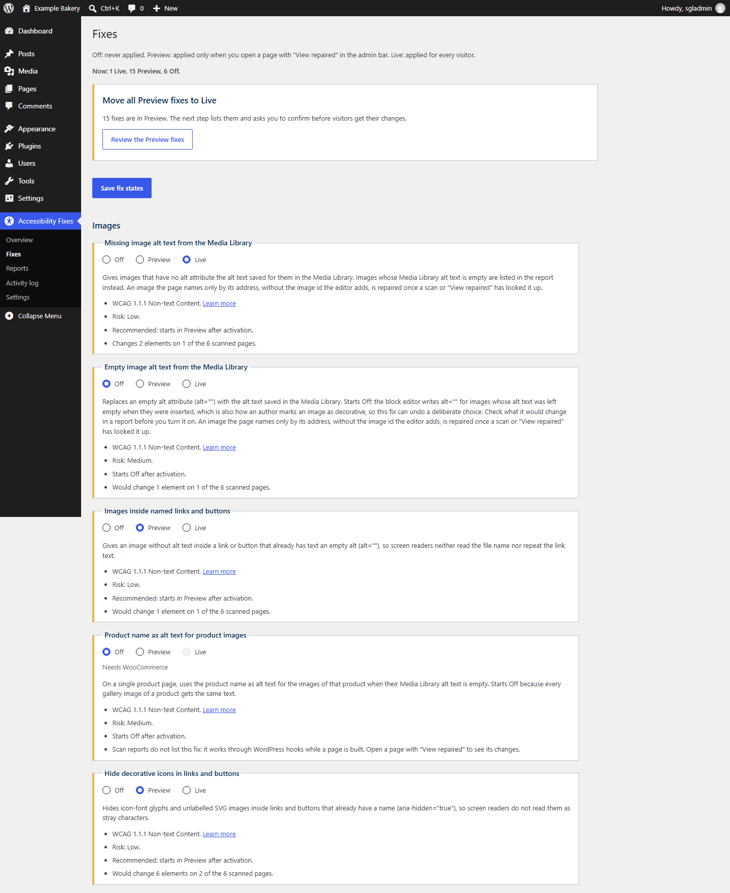
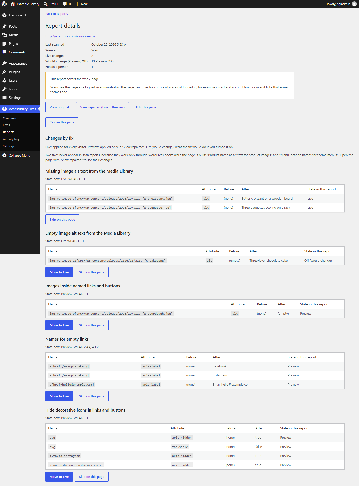
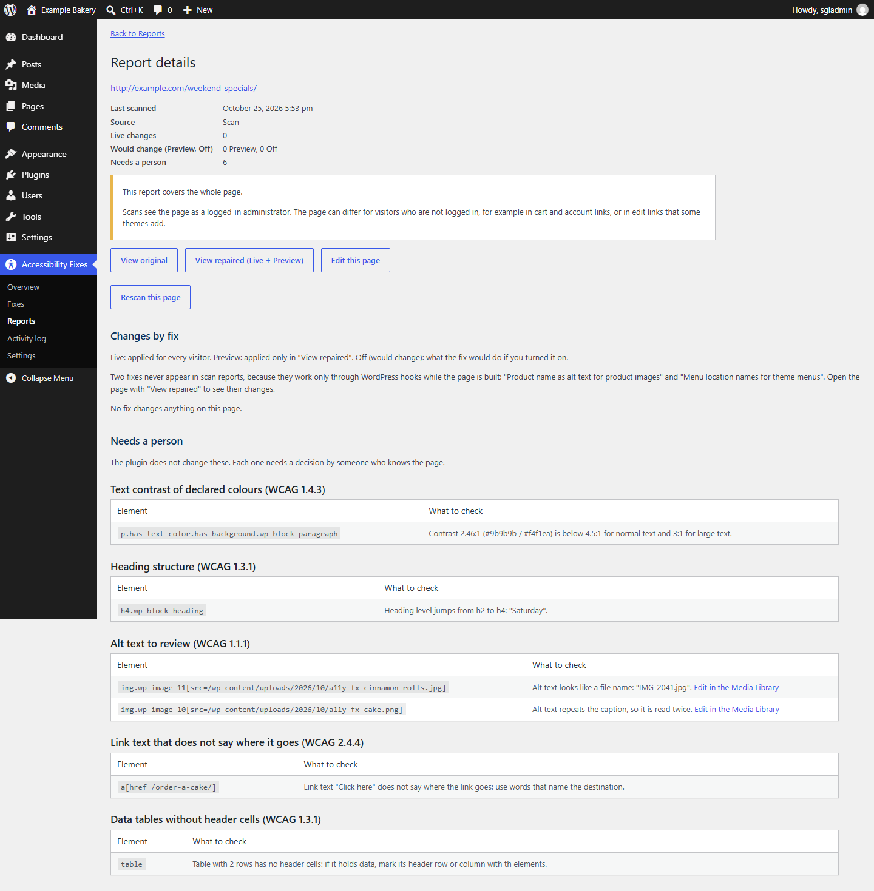
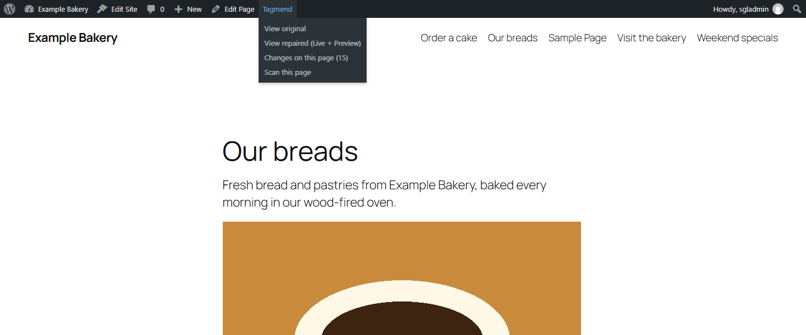
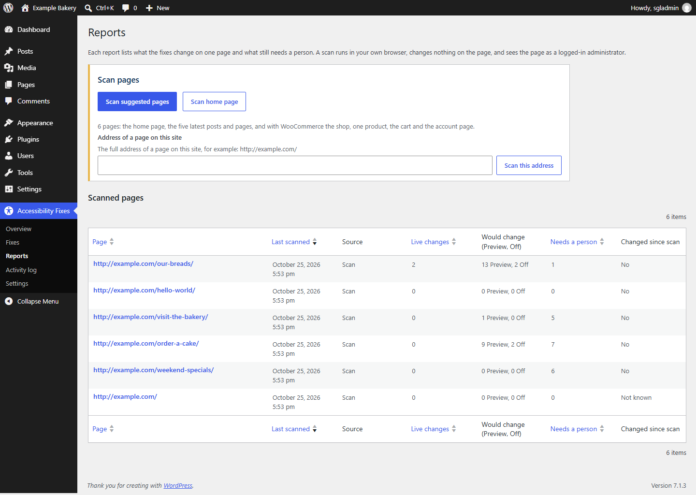
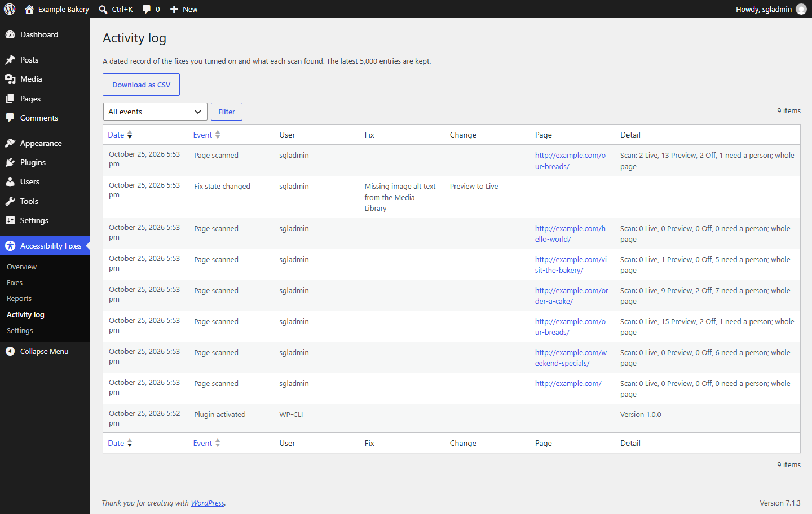

# Tagmend – Accessibility Fixes

A WordPress plugin that makes accessibility fixes in the HTML your theme, page builder and WooCommerce already produce, on your own server, before the page reaches visitors, starting with common WCAG 2.2 failures such as missing labels, empty links and missing alt text. Before a fix goes live you can read every change it makes, element by element, with the value before and after. It is not an overlay: visitors get no toolbar, widget or extra JavaScript, and each fix can be switched off on its own.

No plugin can provide 100% compliance with accessibility laws or standards such as the ADA, the European Accessibility Act or WCAG.
Tagmend reduces common, machine-detectable WCAG failures and lists what still needs a person. Use it alongside testing by people, including people with disabilities.

- Version 1.0.0
- WordPress 6.5 or later (tested up to 7.1), PHP 7.4 or later
- Licence: GPLv2 or later
- Made by [SoftGlaze](https://softglaze.com)

## What it changes

Each repair has its own switch: Off, Preview or Live. The numbers in brackets are the WCAG success criteria concerned.

- **Images:** fills a missing alt attribute from the alt text you set in the Media Library, and marks images inside links and buttons that already have a name as decorative (1.1.1).
- **Links and buttons with no name:** names icon-only links and buttons from reliable sources such as your site name, email and phone links, known social networks, search forms and menu toggles (2.4.4, 4.1.2).
- **Form fields with no label:** gives them an accessible name from the placeholder or a known field name (1.3.1, 4.1.2), and reports that a visible label is still missing (3.3.2).
- **Embedded frames:** gives untitled iframes a title (4.1.2).
- **Page language:** adds or corrects the lang attribute (3.1.1).
- **Skip links:** adds one when the page has none, or repairs one whose target is missing (2.4.1; WordPress 6.9 or later).
- **Zoom:** removes viewport settings that block pinch-zoom (1.4.4; WordPress 6.9 or later).
- **Keyboard order:** removes positive tabindex values and takes hidden duplicate links out of the tab order (2.4.3, 4.1.2).
- **Menus:** labels theme menus with their menu location name (1.3.1, 2.4.1).
- **"Read more" links:** adds the post title to their accessible name (2.4.4).
- **Decorative icons** in named links and buttons, and **empty headings:** hidden from screen readers (1.1.1, 1.3.1).
- **Optional, off until you turn them on:** alt text for empty alt attributes, product image alt from the product name, new-tab notices, a visible focus outline, unique IDs for repeated form fields, and focus fixes inside hidden containers.

## What it reports for a person

- Text contrast where an element sets both its text and background colour itself; other text is marked "not checked".
- Heading structure, landmarks, page titles and repeated IDs (whole pages, WordPress 6.9 or later).
- Alt text that looks like a file name, repeats nearby text or is too long, and images it could not describe.
- Links, buttons and fields it could not name, fields with no visible label, and link text such as "Click here".
- Autoplaying media, data tables without headers, and controls that are not real buttons or links.

## What it does not do

- It does not change the content stored in your database. Repairs happen while the page is built and stop the moment you deactivate the plugin.
- It does not repair markup that JavaScript creates after the page loads, such as slider copies or the WooCommerce Cart and Checkout blocks; reports list such content as "not checked".
- It does not invent alt text, change colours or fix how complex widgets behave with a keyboard.

## How it works

- All processing happens on your server. The plugin sends nothing to SoftGlaze or to anyone else.
- Activating it changes nothing your visitors see: recommended repairs start in Preview.
- It only adds or corrects attributes in your theme's and plugins' markup and never adds, removes or moves their elements. It prints only its own skip link, a hidden "opens in a new tab" note and two small stylesheets, each when that repair is on.
- If anything goes wrong while repairing a page, or the page is very large, your visitors get the page without repairs.
- Whole-page repair (theme headers and footers, builder templates, the page head) uses the page-processing step built into WordPress 6.9 and later. On WordPress 6.5 to 6.8 the plugin repairs post content, template parts, widgets, search forms, menus and featured images only.
- An activity log keeps a dated record of the repairs you turned on and what each scan found.

## Screenshots

**1. The Fixes screen: each repair has its own Off, Preview and Live switch, with the WCAG success criterion and the risk.**



**2. Report details for one page: every change made, with the element, the attribute and the value before and after.**



**3. "Needs a person": the issues the plugin cannot safely repair, such as contrast, heading order and alt text quality.**



**4. The admin bar on a front-end page: view the original page, view the repaired page, or scan it.**



**5. The Reports screen after scanning the suggested pages.**



**6. The activity log: a dated record of the repairs turned on and the scans run.**



## Requirements

- WordPress 6.5 or later (tested up to 7.1). Whole-page repairs and page-level reports need WordPress 6.9 or later.
- PHP 7.4 or later.
- Single sites. Network activation on multisite is refused; activate it on each site instead.

## Installation

Install the plugin from its ZIP file, `tagmend-accessibility-fixes.zip`, attached to each [release](https://github.com/softglazee/tagmend-accessibility-fixes/releases) of this repository together with its SHA-256 checksum, or built with `tools/build-zip.ps1` (see [Building the plugin ZIP](#building-the-plugin-zip)). The archive that GitHub offers under "Code > Download ZIP" is the development repository, not an installable plugin.

1. In WordPress, go to Plugins > Add New Plugin > Upload Plugin, choose the ZIP and activate it.
2. Open Accessibility Fixes > Overview and follow the three steps: scan your home page, review the changes, go live.
3. If you use a page cache, purge it after changing a repair so visitors get the new version.

To turn everything off at once, set a repair to Off, deactivate the plugin, or add `define( 'SOFTGLAZE_A11Y_DISABLE', true );` to `wp-config.php`. Deactivating stops every repair and keeps your settings and reports. Deleting the plugin keeps them too, unless you turned on "Delete all data when the plugin is deleted" in Settings.

## Questions

**Is this plugin enough to meet accessibility laws or WCAG?**
No. No plugin can provide 100% compliance with accessibility laws or standards such as the ADA, the European Accessibility Act or WCAG. This plugin repairs a set of common, machine-detectable errors in your page HTML and lists what still needs a person: colour contrast, heading structure, the quality of alt text, keyboard behaviour of menus and sliders, captions and more. Whether people with disabilities can use your site is something only testing by people can show. This plugin does not give legal advice.

**Can it break my layout?**
Most repairs change attributes such as alt, aria-label, lang and tabindex, which do not change how the page looks. A few can show: an empty submit button gets the text "Submit" or "Search", the skip link appears on keyboard focus, the optional focus outline is visible, and optional unique IDs for repeated form fields can affect styles that select them. You can switch any repair off, skip it on one page, or exclude paths.

**Does it work with page caching?**
Yes. Cached pages contain the repairs. After changing a repair, purge your page cache; the Fixes and Overview screens remind you and name the cache plugin they detect. Scans and admin views are marked as not cacheable.

**Will it slow my site down?**
On the test site (WordPress 7.1, PHP 8.3, WooCommerce active) the repairs took a median of 1 to 8 ms of server time on real pages of 70 to 150 KB, and about 11 ms on a 200 KB page. Cached pages take no extra time.

## Compatibility

Tested on WordPress 6.5 (PHP 7.4) and WordPress 7.1 (PHP 8.3 and 8.4). On WordPress 7.1 it was tested with Elementor 4.3.5 (free version), WooCommerce 11.2.1 and the themes Twenty Twenty-Five 1.5, Astra 4.14.1 and Kadence 1.5.2. Some page builders switch off the WordPress page-processing step; there the page-wide repairs (skip links, zoom, repeated form IDs) and page-level reports do not run, and the Overview says so after a scan.

WooCommerce® and its associated designs are trademarks of Automattic Inc. Elementor, Astra and Kadence are trademarks of their respective owners. This plugin is not affiliated with or endorsed by Automattic or any other owner named here.

## Privacy and external services

The plugin stores scan reports about your own pages (element names and attributes, never form values) and an activity log with the WordPress user IDs of the administrators who changed its fixes or settings or ran scans. It sets no cookies, collects nothing about your visitors and sends nothing off your site. There is no tracking or analytics of any kind.

It does not use any external service, and its PHP code makes no HTTP requests. When you scan pages from the Reports screen or with "Scan this page" in the admin bar, your own browser opens those pages on your own site while you are logged in; nothing is sent anywhere else. The admin screens show links to the W3C "Understanding WCAG 2.2" pages (https://www.w3.org/WAI/WCAG22/Understanding/), which the plugin never requests.

## Development

The plugin is plain PHP with one admin JavaScript file and a few small stylesheets; there is no build step. The tests use the WordPress PHPUnit test library against MariaDB or MySQL.

### Layout

| Path | What it holds |
|---|---|
| `tagmend-accessibility-fixes/` | The plugin. Everything that ships is here. |
| `tests/` | The PHPUnit suite (PHPUnit 9.6 with the WordPress test library): the engine's golden-file, fail-safe, escaping and model tests, every fix and check, the request gate, the data layer, scan security, the admin screens and uninstall. `tests/fixtures/` holds captured pages and the engine's expected output for them. |
| `phpunit.xml.dist`, `phpcs.xml.dist` | PHPUnit and PHP_CodeSniffer configuration. |
| `composer.json`, `composer.lock` | Development packages: PHPUnit, the PHPUnit polyfills, PHP_CodeSniffer, WordPress Coding Standards, PHPCompatibilityWP. |
| `tools/setup-dev.sh` | Downloads WordPress, its test library and the development packages. |
| `tools/run-tests-docker.sh` | Runs the suite in Docker containers (no local PHP or database needed). |
| `tools/run-tests.sh` | Runs the suite with a local PHP and a MySQL or MariaDB server (used by CI). |
| `tools/build-zip.ps1` | Builds and audits the plugin ZIP. |
| `tools/audit-zip.py` | Compares a built ZIP with the plugin folder, or with another ZIP. |
| `tools/plugin-check.sh` | Installs a built ZIP on a test site and runs Plugin Check on the installed copy. |
| `tools/checksums.txt` | Pinned SHA-256 sums and commits of everything `setup-dev.sh` downloads. |
| `tools/fixtures/` | WP-CLI scripts that built the fixture pages on a development site, and `make-expected.php`, which regenerates the expected engine output. |
| `tools/bench/engine-bench.php` | Engine benchmark, run with `wp eval-file` on a development site. |
| `.github/workflows/ci.yml` | Continuous integration: workflow lint, PHPCS, PHPUnit, the ZIP build and audit, and Plugin Check. |

### Setup

You need Git, curl and a POSIX shell (on Windows, Git Bash), plus either Docker, or PHP 7.4 or later with Composer and a MySQL or MariaDB server.

```sh
sh tools/setup-dev.sh
```

The script fetches each item from its own source at a pinned version and checks it:

- WordPress 7.1.3 and 6.5.13 from wordpress.org into `dev/wp-core/`, checked against the SHA-256 sums in `tools/checksums.txt`;
- the WordPress PHPUnit test library of the same releases, a sparse clone of the `wordpress-develop` tag (`tests/phpunit/includes` and `tests/phpunit/data`) into `dev/wp-tests/`, checked against the tag's commit;
- the development packages from `composer.lock` into `vendor/`, with Composer from the PATH or, without it, the `composer:2` Docker image.

Run it again at any time: finished steps are skipped, and `--force` redoes them.

### Running the tests

With Docker:

```sh
sh tools/run-tests-docker.sh
```

This runs the suite three times, on WordPress 7.1.3 with PHP 8.3, WordPress 6.5.13 with PHP 7.4, and WordPress 7.1.3 with PHP 8.4, each in a throw-away container next to a MariaDB 11 container on a private network. `--runs 65-74` picks runs and `--filter <name>` passes a PHPUnit filter. Tests of features that need WordPress 6.9 are skipped on 6.5.

With a local PHP and database server, create the databases `wptests71` and `wptests65` (the test library empties and reinstalls them on every run), then:

```sh
SGL_DB_HOST=127.0.0.1 SGL_DB_USER=root SGL_DB_PASSWORD="<password>" sh tools/run-tests.sh --wp 7.1.3
sh tools/run-tests.sh --wp 6.5.13 --filter Test_Engine_Failsafe
```

### Coding standards

```sh
vendor/bin/phpcs
```

The ruleset in `phpcs.xml.dist` is WordPress, WordPress-Docs and PHPCompatibilityWP for PHP 7.4 and later and WordPress 6.5 and later, with the plugin's prefixes and text domain. Without a local PHP, run it in Docker: `docker run --rm -v "$PWD:/app" -w /app php:8.3-cli vendor/bin/phpcs` (in Git Bash, prefix `MSYS_NO_PATHCONV=1` and use `$(pwd -W)`).

### Building the plugin ZIP

```sh
powershell -NoProfile -ExecutionPolicy Bypass -File tools/build-zip.ps1 -Strict    # Windows PowerShell 5.1
pwsh -NoProfile -File tools/build-zip.ps1 -Strict                                   # PowerShell 7
python3 tools/audit-zip.py dist/tagmend-accessibility-fixes.zip
```

The script reads the plugin's `.distignore`, refuses development files on its own (dotfiles, Markdown, `*.dist`, shell scripts, archives, manifests, development folders), checks that the plugin header and `readme.txt` agree, checks that every text file is UTF-8 without a byte-order mark and with LF line endings, and with `-Strict` that every PHP file has a direct-access guard and uses none of a list of functions the plugin must not call. It writes `dist/tagmend-accessibility-fixes.zip` with forward-slash entries and audits it again. `audit-zip.py` then checks that the ZIP holds exactly the committed plugin files with the same bytes; with `--against <other.zip>` it also compares two ZIPs file by file.

### Plugin Check

`tools/plugin-check.sh <zip>`, run from the WordPress folder of a test site with WP-CLI and [Plugin Check](https://wordpress.org/plugins/plugin-check/) active, installs the ZIP and runs Plugin Check on the installed copy: the command WordPress.org runs on upload, the default run, the security, performance, plugin_repo and accessibility categories, and every check at severity 1. Every run must report no errors and no warnings. CI does this on WordPress 7.1.5 with Plugin Check 2.2.0.

## Reporting security issues

Please report security problems privately, as described in [SECURITY.md](SECURITY.md), not in public issues.

## Changelog

### 1.0.0

- Initial release.

## Licence

GPLv2 or later. See [LICENSE](LICENSE).
